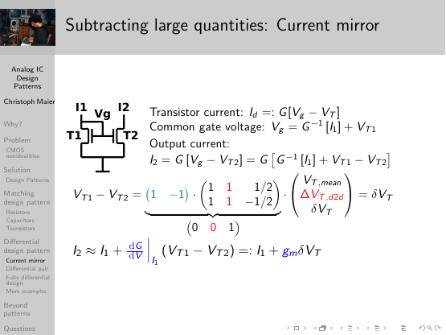
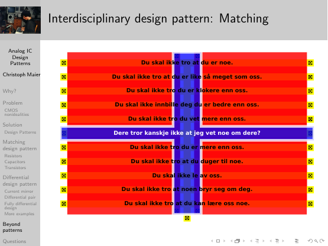
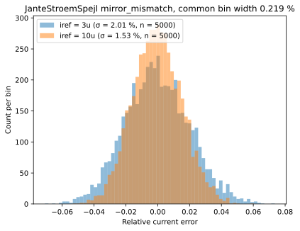
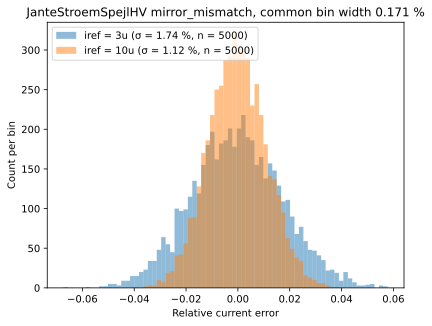
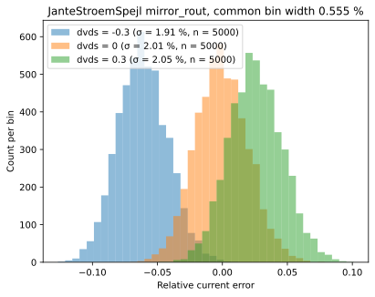
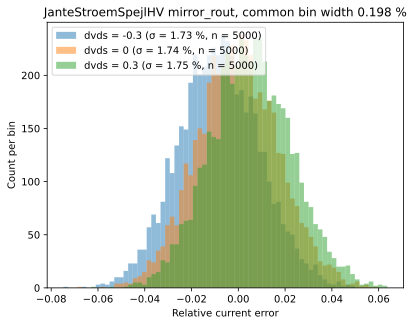

<!--
SPDX-FileCopyrightText: 2026 Christoph Maier
SPDX-License-Identifier: Apache-2.0
-->
# JanteStrømSpejl: a 2019 lecture slide becomes a CACE-characterised current mirror

2026-10-15. Written by Claude (Opus) about work done by ChatGPT and Claude for
Christoph Maier, in `sg13cmos5l_cm_ip__single2diff2single_sudelbuecher/sudelbuecher/JanteStroemSpejl/`.
Pictures are in [pix/](pix/README.md), sources in [ref/](ref/README.md).

## 1. Where it started

On 11 March 2019 Christoph gave a test lecture for a faculty position at UiO:
[*What's All This Analog IC Design Stuff, Anyhow? How to Think Like an Analog IC
Designer*](ref/2019-03-11_Maier_UiO_test_lecture_analog_IC_design.pdf)
([downloads](https://bitbucket.org/cmucsd/analogdesignlecture/downloads/)).
The "Matching design pattern" section explains why a current mirror works.
It *subtracts* two nearly equal threshold voltages, and the large die-to-die
variation cancels, leaving only the small local mismatch δV_T:

The section "Analog Design Thought that Doesn't Fit a Pattern" then builds a
layout slide by slide. It is a 22-transistor, common-source current mirror: eleven
rows of two transistors, a shared source down the middle, a gate-metal cross, and
the diode-connected reference pair in the cross arm. Drawn in red poly, yellow
diffusion and blue metal, it is the Norwegian flag. Each of the ten output rows
carries one rule of the Jante Law. The reference row carries the eleventh:

The joke is exact. A current mirror is a circuit whose specification *is*
Janteloven: no output may be more than any other. The row that "knows something
about everybody" is the one that sets everybody's gate voltage.

## 2. What happened on 15 October 2026

**ChatGPT** session "Russische Etymologie Nemez", morning to 17:11
([transcript PDF](6ad0a469-05d8-83eb-889f-0b6d945ad274.pdf), [Appendix B](#appendix-b-chatgpt-session-timeline)):

- **The joke.** It began with the etymology of немец, "German", originally "the
  mute one", the one who cannot speak our language. It ended with a LinkedIn image:
  the Danish-flag variant of the layout with Fleet Admiral Chester W. Nimitz,
  "Адмирал немец" ([JanteStroemSpejl_Nimitz.png](JanteStroemSpejl_chat_export/pix/JanteStroemSpejl_Nimitz.png)).
  It took several corrections before ChatGPT left the layout unmodified: "red is
  poly, yellow is diffusion, white is metal".
- **Layout to netlist.** Asked to turn the picture into a circuit, it read the
  artwork as layout and produced a correct 22-device netlist
  ([JanteStroemSpejl_explicit22.spice](JanteStroemSpejl_explicit22.spice),
  [contact port map](JanteStroemSpejl_contact_port_map.txt)). Each row is two
  separate `sg13_lv_nmos` (W/L = 4λ/64λ, λ = 0.08 µm), with no `m`/`ng` arraying.
  Row 6 is diode-connected and the twenty other drains pair into ten outputs.
  It also produced an xschem schematic, [JanteStroemSpejl.sch](JanteStroemSpejl.sch),
  and the development testbench [JanteStroemSpejl_tb_mismatch.sch](JanteStroemSpejl_tb_mismatch.sch).
  With the user's corrections (one transistor having all the mismatch, a sign
  error), that testbench gave plausible mismatch data. That was real, useful work.
- **CACE.** Asked for a CACE histogram, it wrote a YAML, a template and a pooling
  script. Seven CACE runs (15:39 to 16:54, [runs/](runs/)) failed. Instead of
  reading the CACE source, it guessed placeholder syntax, tried a template type
  CACE does not support, and re-zipped unchanged files under new names
  ([zipslop/](zipslop/)). It ended by exporting the chat at the user's request
  ([JanteStroemSpejl_chat_export/](JanteStroemSpejl_chat_export/)).

**Claude** session, from 17:22 (this report):

- **Toolchain.** Rebuilt the pinned toolchain of the user's IIC-OSIC-TOOLS image,
  following [cloud_environment.md](../cloud_environment.md).
- **Diagnosis.** Read the CACE 2.11.0 source and found three plumbing bugs
  ([Appendix A](#appendix-a-the-cace-fix-line-by-line)): unescaped `CACE\{…\}`
  placeholders, the wrong result-file name and a missing DUT `.include`.
  ChatGPT's design is otherwise kept, including its VDUMMY iteration marker; a
  SEED line makes runs reproducible.
- **Bias.** The first working run showed every output 2 % low. The cause was the
  bias, inherited from the development testbench: 100 µA from an ideal current
  source forced V_GS = 3.3 V on 1.2 V thin-oxide devices. That is twice the
  [process spec](ref/README.md#external)'s V_GS limit of 1.65 V and above the
  2.0 V minimum drain breakdown. Neither ChatGPT nor its user had noticed, because
  the ideal source ignores the 1.2 V supply drawn next to it.
  The CACE testbench now runs at 3 µA and 10 µA.
  The development testbench has `.param IREF=10u`, chosen from a corner sweep
  ([Appendix C](#appendix-c-choice-of-iref-for-the-development-testbench)).
- **Extensions.** Added two follow-up studies the user asked for: output
  resistance vs. mismatch, and the same mirror in thick-oxide `sg13_hv_nmos`
  ([JanteStroemSpejlHV.sch](JanteStroemSpejlHV.sch)).
- **Fair histograms.** Spotted by the user: CACE gives each histogram its own
  bin width, so their peak heights can't be compared. Added
  [replot_shared_bins.py](cace/scripts/replot_shared_bins.py).

## 3. Results (500 seeded mismatch runs × 10 outputs per histogram)

| Device | IREF | V(IREF) | mean error | σ (pooled) |
|---|---|---|---|---|
| sg13_lv_nmos | 3 µA | 0.59 V | −0.04 % | 2.0 % |
| sg13_lv_nmos | 10 µA | 0.90 V | −0.04 % | 1.5 % |
| sg13_hv_nmos | 3 µA | 1.27 V | −0.03 % | 1.7 % |
| sg13_hv_nmos | 10 µA | 1.82 V | −0.02 % | 1.1 % |

All histograms above and below use common bin edges. In CACE's own plot
([pix/lv_mismatch_cace_auto_bins.svg](pix/lv_mismatch_cace_auto_bins.svg)), each
condition set gets `bins="auto"`. The bin width then scales with each set's σ,
so at equal sample counts the peaks come out equally high by construction.

**Output resistance vs. mismatch** (3 µA; outputs at V_DS = V_GS(ref) + ΔV):

| ΔV | LV mean | LV σ | HV mean | HV σ |
|---|---|---|---|---|
| −0.3 V | −6.1 % | 1.9 % | −0.82 % | 1.7 % |
| 0 | −0.04 % | 2.0 % | −0.03 % | 1.7 % |
| +0.3 V | +2.6 % | 2.1 % | +0.54 % | 1.7 % |

Moving the output voltage shifts the whole distribution and leaves its width
alone. For LV above saturation the shift is ≈ 8.5 %/V, an effective Early
voltage of about 12 V even at L = 5.12 µm. The −0.3 V point (V_DS = 0.29 V) is
already near the saturation knee. Over a ±0.3 V output swing the systematic
spread, 8.7 %, is four times the random σ. At this bias, a cascode is worth more
than a bigger device.

**Thick oxide.** The same geometry in `sg13_hv_nmos`, at the same currents, has a
smaller spread: σ is 14 % smaller at 3 µA and 27 % smaller at 10 µA. That is
despite an A_VT almost twice as large, 7.0 vs. 3.9 mV·µm in the PDK's
[mismatch model](ref/README.md#external). At the same current, the thick-oxide
device runs at a much larger overdrive (V_GS = 1.27 V and 1.82 V), so g_m/I is
lower and each millivolt of V_T scatter costs less current. Its output resistance
is also about four times higher. The shift is ≈ 2.3 %/V (V_A ≈ 45 V), so over
±0.3 V the systematic spread (1.4 %) stays below σ. "Same operating conditions"
here means the same currents and the same V_DS = V_GS bias; the voltages
themselves differ. The HV mirror needs more headroom: a 1.2 V supply would not
fit it.

## 4. Perspective

The same picture went out again on 15 October 2026 as a
[LinkedIn post](https://lnkd.in/p/ez5utx59): "Hierdie woordspeling val op dowe ore
vir diegene wat nie Nederlands of Afrikaans praat nie." The post is tagged
"Doofe Ohren" and signed "Приветствие, Адмирал немец". It is a pun on deaf ears:
Dutch *doof* means deaf, German *doof* means dumb, немец means mute.
It follows a run of posts aimed, by Christoph's own account without echo, at
Eriksholm, Oticon's hearing research centre, which is "committed to making
audiological discoveries". Its
[Partner with Eriksholm](https://eriksholm.com/partner-with-eriksholm/) page
invites "recognized scientists" to reach out:

- 11 Oct, [Hearing aid, reimagined](https://www.linkedin.com/feed/update/urn:li:activity:7515076170397425664/):
  Christiane Nüsslein-Volhard ("Creativity is combining facts no one else has
  connected before") celebrating her retirement with a
  [Quodlibet](https://www.flickr.com/photos/89067995@N00/albums/72177720303647432/),
  answered with the [Quodlibet section of Christoph's 2000 ETH dissertation](https://cmucsd.bitbucket.io/akademix/PhD.pdf#page=168)
  and Goethe's *licet quod decet* vs. *licet quod libet*.
- 12 Oct, [Albert Einstein on Discovery](https://www.linkedin.com/feed/update/urn:li:activity:7515330936675401728/)
  ([*The Atlantic*, Nov. 1945](https://www.theatlantic.com/magazine/archive/1945/11/einstein-on-the-atomic-bomb/656626/)):
  "Only a free individual can make a discovery". A comment quotes Eriksholm's
  invitation verbatim.

The files next to this report show that the 2019 slide is a design artifact as
well as a joke. A language model can read it as a layout and turn it into a
netlist. An open PDK and CACE then turn the netlist into a calibrated statement:
a Jante mirror keeps its ten outputs within a few percent of one another, and no
closer. Getting from a plausible histogram to a correct one took three checks that
no tool volunteered: reading the CACE source when its error messages explained
nothing, noticing that the bias source was running 1.2 V gates at 3.3 V, and
noticing that two histograms with different σ had suspiciously equal peaks.
The last one was the user's.

## Appendix A: The CACE fix, line by line

Template [cace/templates/JanteStroemSpejl_cace_mismatch.sch](cace/templates/JanteStroemSpejl_cace_mismatch.sch),
against ChatGPT's last version:

| # | ChatGPT | now | why |
|---|---|---|---|
| 1 | `value=CACE{iterations}` | `value=CACE\{iterations\}` | CACE 2.11.0, `parameter.py`, `get_condition_names_used(escape=True)`: for `.sch` templates and cace_format 5.2 the regex is `CACE\\\{([^ \}\t]+)\\\}`. Unescaped placeholders are invisible, which is the source of "No conditions found" and "Couldn't find condition iterations". |
| 2 | `> CACE{simpath}/CACE{filename}.data` | `> CACE\{simpath\}/CACE\{filename\}_CACE\{N\}.data` | `parameter_ngspice.py` reads `<template>_<index><suffix>`. |
| 3 | (none) | `.include CACE\{DUT_path\}` | CACE rewrites the DUT symbol to `type=primitive` for the testbench, so the subcircuit must be included. |
| 4 | `IREFSRC value=100u`, `/100u` | `value=CACE\{iref\}`, `/CACE\{iref\}` | 100 µA gives V(IREF) = 3.3 V (Section 2). The conditions are 3u and 10u. |
| 5 | (none) | `.option SEED=CACE[CACE\{seed=12345\} + CACE\{iterations=0\}]` | Reproducible draws; same line as `macros/inverter`. Without it ngspice seeds from the process id. |
| 6 | (none) | `.lib cornerMOShv.lib mos_tt_mismatch`, `C {CACE\{DUT_name\}.sym}`, `VDVDS DREF IREF CACE\{dvds=0\}` | One template serves the LV and the HV datasheet and the r_out sweep. With dvds = 0 the LV results are bit-identical to the version without these lines. |

Datasheets: [cace/JanteStroemSpejl.yaml](cace/JanteStroemSpejl.yaml) and
[cace/JanteStroemSpejlHV.yaml](cace/JanteStroemSpejlHV.yaml), both with
`documentation: docs`. Pooling script: ChatGPT's
[cace/scripts/pool_mismatch.py](cace/scripts/pool_mismatch.py), unchanged.

Systematic error with typical models (no mismatch), by IREF, LV:
100 µA: V(IREF) 3.32 V, −2.0 %; 30 µA: 1.49 V, −0.10 %; 10 µA: 0.90 V, −0.018 %; 3 µA: 0.59 V, −0.009 %.

Where ChatGPT went astray, apart from the bugs:

- The VDUMMY rationale ("so CACE sees the iterations condition") was wrong.
  `CACE\{…\}` is found anywhere in the file, including `code_shown` blocks.
  VDUMMY is kept as a visible, electrically isolated iteration marker.
- Runs [16:33](runs/RUN_2026-10-15_16-33-14/error.log) and
  [16:37](runs/RUN_2026-10-15_16-37-43/error.log) tried a `.spice` template.
  CACE 2.11.0 answers "TODO: Implement substitution for spice templates!".
- At 16:51 and 16:54 it had located `get_condition_names_used()` in the user's
  pasted code but had not read it.
- [cace/templates/xschemrc](cace/templates/xschemrc) is unused. CACE netlists
  with the PDK's xschemrc.

CACE 2.11.0 quirks:

- **Misleading histogram bins.** Each condition set is drawn with its own
  `bins="auto"` (`parameter.py`, line 1367), so peak heights can't be compared.
  The workaround is [replot_shared_bins.py](cace/scripts/replot_shared_bins.py);
  the real fix belongs upstream.
- **Cropped title (cosmetic).** With more than one condition set the plot gets a
  legend, and `savefig(bbox_extra_artists=[legend])` crops the title.
- **Parallel xschem crash.** In 1 of 5 runs, two xschem processes started for
  two parameters at once crashed (`Tcl_AppInit`, exit −11). Use
  `--parallel-parameters 1`.

## Appendix B: ChatGPT session timeline

From the [user's PDF print](6ad0a469-05d8-83eb-889f-0b6d945ad274.pdf) of
[chatgpt.com/c/6ad0a469-05d8-83eb-889f-0b6d945ad274](https://chatgpt.com/c/6ad0a469-05d8-83eb-889f-0b6d945ad274)
(53 pages, printed 17:11) and [JanteStroemSpejl_chat_export/](JanteStroemSpejl_chat_export/).
Times are where the log shows them. User turns are quoted in their original language.

1. "etymologie russisch für deutsche: nemez". немец comes from немой, "mute".
2. The user uploads [JanteStroemSpejl.svg](JanteStroemSpejl.svg) and asks for a
   mashup with "diesem 'stummen' Großadmiral vor der dänischen Janteloven-Fahne …
   so, dass alle 10+1 Gebote lesbar und nicht verdeckt sind".
3. ChatGPT alters the flag. The user: "Lass die Janteloven-Fahne unverändert und die
   Sprache auch. Den Witz mit dem Layout der Fahne verstehst du nicht und machst
   ihn kaputt." Then "Oder kannst du CMOS-Layouts lesen?" ChatGPT answers yes,
   within limits.
4. Layer correction by the user: "Rot ist Polysilizium, gelb ist Diffusion",
   "Weiss ist Metall". The mashup succeeds after the user has the canvas extended
   and Nimitz placed beside the circuit
   ([JanteStroemSpejl_Nimitz.png](JanteStroemSpejl_chat_export/pix/JanteStroemSpejl_Nimitz.png)).
5. "Mach da mal eine Schaltung draus, skaliert auf lambda … als xschem-Schaltung
   für IHP sg13cmos5L". The first schematic has broken `m`/`ng`. The user asks for
   an ngspice netlist first, which becomes
   [JanteStroemSpejl_explicit22.spice](JanteStroemSpejl_explicit22.spice) and
   [JanteStroemSpejl_contact_port_map.txt](JanteStroemSpejl_contact_port_map.txt),
   then the schematic and the mismatch testbench.
6. Iterations in the IIC-OSIC-TOOLS container: "BARF" (5 MB of ngspice output),
   the netlist location, "Can you do it or should I ask Claude?", nine outputs
   stuck at −1 (only one device had mismatch), the current sign fix. Result: a
   working five-run development testbench.
7. "Ok, can you use CACE to produce a nice histogram of the runs?" ChatGPT
   delivers YAML, template and script without running them.
8. Seven failed CACE runs. The user asks for the latest ZIP; the ZIPs carry
   13:40 timestamps; "You're giving me crap"; re-zipping; "you just touched the
   otherwise unmodified files and produced a shitload of administrative clutter".
   ChatGPT agrees.
9. ChatGPT asks for `get_condition_names_used()`. The user pastes the surrounding
   code, and the user requests a verbatim export of the chat.

## Appendix C: Choice of IREF for the development testbench

[JanteStroemSpejl_tb_mismatch.sch](JanteStroemSpejl_tb_mismatch.sch) now has a
`PARAMS` block with `.param IREF=10u` and `.csparam irefval=IREF`. The current
source uses `{IREF}`, and the `.control` normalisation uses `irefval`, so the
value is set in one place.

The reference pair runs at V_DS = V_GS = V(IREF), and every output is clamped to
the same voltage. The worst case is therefore the largest V(IREF) over process
corner and temperature. A DC sweep of IREF (typical models without mismatch,
`mos_{tt,ss,ff,sf,fs}`, −55 / 27 / 125 °C) gives:

| corner | T | IREF at V(IREF) = 1.2 V | IREF at 1.65 V | V(IREF) at 10 µA |
|---|---|---|---|---|
| ss | 125 °C | **11.9 µA** | **23.0 µA** | **1.11 V** |
| sf | 125 °C | 12.7 µA | 24.2 µA | 1.08 V |
| tt | 125 °C | 13.5 µA | 25.4 µA | 1.04 V |
| tt | 27 °C | 19.3 µA | 36.0 µA | 0.90 V |
| ff | −55 °C | 30.3 µA | 53.1 µA | 0.75 V |

The highest V(IREF) always occurs at +125 °C; at this overdrive, falling mobility
outweighs falling V_T. The ss corner at +125 °C sets the limit:

- V_GS ≤ 1.65 V (SG13CMOS5L spec §2.1.1, TDDB at 125 °C) allows up to 23 µA.
- The drain limit (BV_DSS ≥ 2.0 V) doesn't bind, because the outputs sit at V(IREF).
- 10 µA keeps V(IREF) ≤ 1.11 V everywhere: inside the rating with 0.54 V margin,
  and below the testbench's 1.2 V supply. A real current source would need that
  headroom; the ideal one in the testbench does not.
- The mismatch spread (σ ≈ 1.5 % in current, a few mV in V_GS) doesn't change
  this choice.

## Appendix D: Reproduction

Inside IIC-OSIC-TOOLS (2026.09: CACE 2.11.0, ngspice-47, xschem 3.4.8RC
ddc7344, IHP dev c271a7e9), from this directory:

    cace cace/JanteStroemSpejl.yaml   --source schematic -j 8 --parallel-parameters 1
    cace cace/JanteStroemSpejlHV.yaml --source schematic -j 8 --parallel-parameters 1
    python3 cace/scripts/replot_shared_bins.py runs/RUN_<date>

Each CACE run takes about 10 minutes and writes the following, which are
overwritten on every run:

- `runs/RUN_<date>/summary.md` and `parameters/{mirror_mismatch,mirror_rout}/`
  (CACE histograms, `simulation_summary.{md,csv}`, one directory per iteration)
- `docs/JanteStroemSpejl[HV].md` and `docs/JanteStroemSpejl[HV]_schematic.md`
  (datasheet with symbol, schematic and plots)

The numbers in this report come from the same versions built in a cloud container,
per [cloud_environment.md](../cloud_environment.md). Two reruns gave bit-identical
`.data` files.

Files touched by Claude:

- [cace/JanteStroemSpejl.yaml](cace/JanteStroemSpejl.yaml): fixed; `iref`,
  `mirror_rout` and `documentation: docs` added.
- [cace/JanteStroemSpejlHV.yaml](cace/JanteStroemSpejlHV.yaml): new; the same
  datasheet with name `JanteStroemSpejlHV`.
- [cace/templates/JanteStroemSpejl_cace_mismatch.sch](cace/templates/JanteStroemSpejl_cace_mismatch.sch):
  see [Appendix A](#appendix-a-the-cace-fix-line-by-line).
- [cace/scripts/replot_shared_bins.py](cace/scripts/replot_shared_bins.py): new.
- [JanteStroemSpejlHV.sch](JanteStroemSpejlHV.sch) and [JanteStroemSpejlHV.sym](JanteStroemSpejlHV.sym):
  new. `JanteStroemSpejl.sch` with `sg13_lv_nmos` → `sg13_hv_nmos`; same geometry,
  which is above the HV minimum of W 0.30 µm and L 0.45 µm.
- [JanteStroemSpejl_tb_mismatch.sch](JanteStroemSpejl_tb_mismatch.sch): IREF as a
  parameter, set to 10u ([Appendix C](#appendix-c-choice-of-iref-for-the-development-testbench)).
- [README.txt](README.txt): fix log.
- This file, [pix/](pix/README.md) and [ref/](ref/README.md).

Unchanged: [JanteStroemSpejl.sch](JanteStroemSpejl.sch) and [.sym](JanteStroemSpejl.sym),
[cace/scripts/pool_mismatch.py](cace/scripts/pool_mismatch.py).

## Appendix E: Sources

Full index with all links: [ref/README.md](ref/README.md). The main ones:

- C. Maier, [UiO test lecture, 11 March 2019](ref/2019-03-11_Maier_UiO_test_lecture_analog_IC_design.pdf)
  ([Bitbucket](https://bitbucket.org/cmucsd/analogdesignlecture/downloads/))
- C. H. Maier, [Diss. ETH No. 13532, 2000, "Quodlibet", p. 167](https://cmucsd.bitbucket.io/akademix/PhD.pdf#page=168)
- LinkedIn posts by C. Maier:
  [15 Oct](https://lnkd.in/p/ez5utx59),
  [12 Oct](https://www.linkedin.com/feed/update/urn:li:activity:7515330936675401728/),
  [11 Oct](https://www.linkedin.com/feed/update/urn:li:activity:7515076170397425664/),
  [7 Oct](https://www.linkedin.com/feed/update/urn:li:activity:7513535125842739201/),
  [6 Oct](https://www.linkedin.com/feed/update/urn:li:activity:7513177256240930817/)
- A. Einstein, ["Einstein on the Atomic Bomb", *The Atlantic*, Nov. 1945](https://www.theatlantic.com/magazine/archive/1945/11/einstein-on-the-atomic-bomb/656626/)
- [Eriksholm Research Centre, "Partner with Eriksholm"](https://eriksholm.com/partner-with-eriksholm/)
- [IHP SG13CMOS5L process specification](https://github.com/iic-jku/IHP-Open-PDK/blob/c271a7e97a7bab201c1d0a399215969d2ee19573/ihp-sg13cmos5l/libs.doc/doc/SG13CMOS5L_os_process_spec.pdf), §2.1.1
- [CACE 2.11.0 on PyPI](https://pypi.org/project/cace/2.11.0/)
